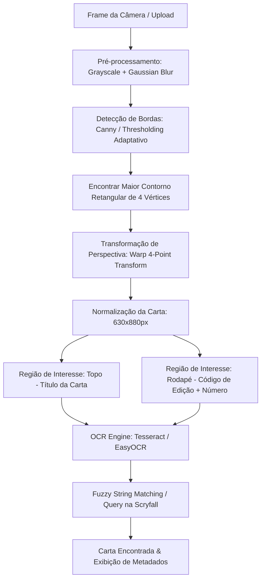
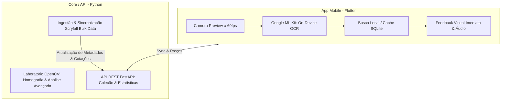

# Especificação Técnica e de Requisitos (PRD)
## Projeto: MTG Card Scanner & Collection Tracker

---

## 1. Visão Geral e Objetivos

O objetivo deste projeto é construir uma solução completa para catalogação automatizada, precificação e gerenciamento de coleções de **Magic: The Gathering (MTG)** a partir da captura fotográfica das cartas físicas.

### Metas Principais
1. **Catalogar o acervo pessoal (~1.000 cartas)** de forma ágil, minimizando digitação manual.
2. **Avaliação Financeira**: Identificar instantaneamente o valor de mercado das cartas (identificando edições valiosas, foils e raridades).
3. **Aprendizado & Portfólio**: Exercitar conceitos de Visão Computacional (OpenCV/OCR), engenharia de dados (APIs da Scryfall e dumps em massa), arquitetura de banco de dados e UX responsiva para captura via câmera.

---

## 2. Personas e Casos de Uso

### Casos de Uso Primários
- **UC01 - Escanear Carta com Câmera**: Usuário aponta o celular para a carta física; o sistema identifica a carta, a edição e mostra a cotação em tempo real.
- **UC02 - Confirmação e Ajuste**: Caso haja ambiguidade (reimpressões de edições diferentes), o usuário seleciona a variante correta com 1 toque.
- **UC03 - Adicionar à Coleção**: Registrar quantidade, estado de conservação (NM, SP, MP, HP), idioma e se é foil.
- **UC04 - Dashboard de Coleção & Preços**: Visualizar valor total da coleção, cartas mais caras, distribuição por cores, raridades e formatos legais (Commander, Modern, Standard).
- **UC05 - Importação/Exportação**: Suporte a exportar/importar listas em formato CSV padrão (ManaBox, Moxfield, MTG Arena).

---

## 3. Pipeline de Visão Computacional (Image Analysis)

Este é o componente central de aprendizado prático do projeto.

### Detalhes das Etapas:
1. **Detecção da Borda da Carta**:
   - Cartas de Magic possuem proporção fixa (~63mm x 88mm, proporção de aproximadamente 1:1.4).
   - Utilização de `cv2.findContours` filtrando contornos convexos com 4 vértices e proporção compatível.
2. **Warp de Perspectiva**:
   - Correção de rotação e inclinação (*homografia*), gerando uma imagem retangular padronizada.
3. **Segmentação de ROI (Region of Interest)**:
   - **ROI 1 (Título)**: Retângulo superior (5% a 15% da altura). Extrai o nome da carta via OCR.
   - **ROI 2 (Rodapé de Colecionador)**: Em cartas pós-2015, o canto inferior esquerdo contém a sigla da coleção (3 letras) e o número da carta (ex: `MH2 • EN 144`). Isso garante 100% de precisão na edição.
4. **Resolução de Ambiguidade**:
   - Se o OCR ler apenas o nome, o sistema busca na base local e exibe um carrossel das edições possíveis ordenadas pela mais recente ou mais provável.

---

## 4. Decisão de Stack e Arquitetura do Sistema

A arquitetura adota a **Estratégia Híbrida**:

### Tecnologias Escolhidas:
1. **Frontend / Mobile**:
   - **Framework**: **Flutter** (Dart 3+).
   - **Scanner On-Device**: `google_mlkit_text_recognition` + `camera` para leitura de texto instantânea sem latência de rede.
   - **Armazenamento Local**: SQLite (`sqflite` / `drift`) para funcionamento 100% offline da coleção e índice rápido de cartas.
2. **Backend & Data Engine**:
   - **Linguagem**: **Python 3.12+**.
   - **Laboratório de Visão**: OpenCV (`cv2`), NumPy (para experimentos de homografia, segmentação de arte e análise detalhada).
   - **API / Sync**: FastAPI + HTTPX/Requests para consultar e processar os dados da Scryfall.
   - **Banco Central**: PostgreSQL ou SQLite compartilhado.

---

## 5. Roadmap de Desenvolvimento em Fases

### Fase 1: Fundação de Dados e Integração Scryfall (Python)
- [ ] Substituir o script legado `mtgsdk` por cliente moderno da **Scryfall API**.
- [ ] Implementar busca por nome (EN e PT-BR) e extração de cotações (`prices.usd`, `prices.usd_foil`, `prices.eur`).
- [ ] Baixar e filtrar o dump `default-cards.json` da Scryfall para gerar base leve e rápida.

### Fase 2: Laboratório de Imagem & OpenCV (Python)
- [ ] Criar pipeline com OpenCV para detecção de cartas físicas em imagens reais (correção de perspectiva / 4-point transform).
- [ ] Testar extração das regiões críticas: título superior e rodapé inferior (código de edição e número).

### Fase 3: App Mobile & Scanner em Tempo Real (Flutter)
- [ ] Inicializar o projeto Flutter no repositório.
- [ ] Implementar tela de Scanner com preview da câmera e overlay de mira da carta.
- [ ] Integrar `google_mlkit_text_recognition` para leitura em tempo real sem lag.
- [ ] Cruzamento do texto lido com a base de cartas (resolução de ambiguidades com feedback tátil/sonoro).

### Fase 4: Gerenciamento de Coleção & Dashboard Financeiro
- [ ] Telas de gerenciamento: lista da coleção, filtros por cor, tipo, formato e valor.
- [ ] Dashboard financeiro com soma total do acervo e exibição das "cartas mais caras".
- [ ] Exportação para CSV (compatível com LigaMagic, ManaBox e Moxfield).

---

## 6. Próximos Passos Imediatos
1. Iniciar a **Fase 1**: atualizar o ambiente Python e criar o módulo de busca na **Scryfall API** com cotação real.

