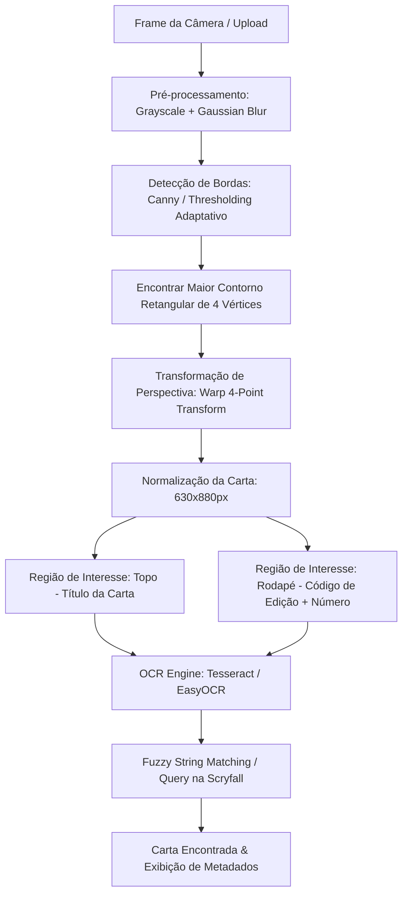
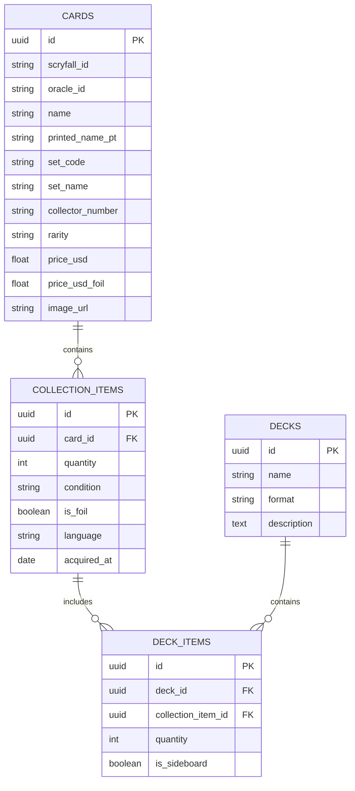

# Especificação Técnica e de Requisitos (PRD)
## Projeto: MTG Card Scanner & Collection Tracker

---

## 1. Visão Geral e Objetivos

O objetivo deste projeto é construir uma solução completa para catalogação automatizada, precificação e gerenciamento de coleções de **Magic: The Gathering (MTG)** a partir da captura fotográfica das cartas físicas.

### Metas Principais
1. **Catalogar o acervo pessoal (~1.000 cartas)** de forma ágil, minimizando digitação manual.
2. **Avaliação Financeira**: Identificar instantaneamente o valor de mercado das cartas (identificando edições valiosas, foils e raridades).
3. **Aprendizado & Portfólio**: Exercitar conceitos de Visão Computacional (OpenCV/OCR), engenharia de dados (APIs da Scryfall e dumps em massa), arquitetura de banco de dados e UX responsiva para captura via câmera.

---

## 2. Personas e Casos de Uso

### Casos de Uso Primários
- **UC01 - Escanear Carta com Câmera**: Usuário aponta o celular para a carta física; o sistema identifica a carta, a edição e mostra a cotação em tempo real.
- **UC02 - Confirmação e Ajuste**: Caso haja ambiguidade (reimpressões de edições diferentes), o usuário seleciona a variante correta com 1 toque.
- **UC03 - Adicionar à Coleção**: Registrar quantidade, estado de conservação (NM, SP, MP, HP), idioma e se é foil.
- **UC04 - Dashboard de Coleção & Preços**: Visualizar valor total da coleção, cartas mais caras, distribuição por cores, raridades e formatos legais (Commander, Modern, Standard).
- **UC05 - Importação/Exportação**: Suporte a exportar/importar listas em formato CSV padrão (ManaBox, Moxfield, MTG Arena).

---

## 3. Pipeline de Visão Computacional (Image Analysis)

Este é o componente central de aprendizado prático do projeto.

### Detalhes das Etapas:
1. **Detecção da Borda da Carta**:
   - Cartas de Magic possuem proporção fixa (~63mm x 88mm, proporção de aproximadamente 1:1.4).
   - Utilização de `cv2.findContours` filtrando contornos convexos com 4 vértices e proporção compatível.
2. **Warp de Perspectiva**:
   - Correção de rotação e inclinação (*homografia*), gerando uma imagem retangular padronizada.
3. **Segmentação de ROI (Region of Interest)**:
   - **ROI 1 (Título)**: Retângulo superior (5% a 15% da altura). Extrai o nome da carta via OCR.
   - **ROI 2 (Rodapé de Colecionador)**: Em cartas pós-2015, o canto inferior esquerdo contém a sigla da coleção (3 letras) e o número da carta (ex: `MH2 • EN 144`). Isso garante 100% de precisão na edição.
4. **Resolução de Ambiguidade**:
   - Se o OCR ler apenas o nome, o sistema busca na base local e exibe um carrossel das edições possíveis ordenadas pela mais recente ou mais provável.

---

## 4. Arquitetura de Dados e Integração

### Fonte de Dados: Scryfall API
- **Bulk Data**: Em vez de fazer requisições HTTP para cada frame/teste, baixar o arquivo `default-cards.json` da Scryfall (~300MB) contendo todo o histórico de cartas de Magic com IDs únicos, nomes em inglês e português, preços e links de imagem.
- **Indexação Local**:
  - Tabela de cartas com busca textual (Trigram ou Full-Text Search) para buscas fuzzy ultra-rápidas (< 5ms).
- **Preços**:
  - A Scryfall fornece preços diários em USD (`prices.usd`, `prices.usd_foil`) e EUR (`prices.eur`).
  - Opcional: Conversão cambial automática ou integração futura com LigaMagic para mercado brasileiro.

### Modelo de Dados Relacional (Sugerido)

---

## 5. Roadmap de Desenvolvimento em Fases

Para garantir a conclusão do projeto e evitar sobrecarga, dividimos a execução em 4 fases:

### Fase 1: Fundação de Dados & Script de Cotação (Semana 1)
- [ ] Baixar e processar o dump da Scryfall.
- [ ] Criar banco de dados local (SQLite ou Postgres).
- [ ] Criar função de busca aproximada por nome (ex: digitar "Liliana" e listar opções com preço).
- [ ] Importar/Exportar CSV básico.

### Fase 2: Protótipo do Scanner de Visão Computacional (Semana 2)
- [ ] Criar script Python com OpenCV:
  - Carregar foto de teste de uma carta.
  - Detectar bordas e aplicar transformação de perspectiva (desentortar).
  - Recortar faixa de título.
  - Executar OCR (Tesseract / EasyOCR) e passar o texto para a busca da Fase 1.
- [ ] Medir acurácia em um conjunto de 10-20 cartas de teste com iluminações diferentes.

### Fase 3: Backend da Aplicação & API (Semana 3)
- [ ] Criar API REST (FastAPI) para:
  - Endpoint de upload de imagem -> retorna sugestões de cartas identificadas.
  - Endpoints de CRUD da coleção (adicionar carta, remover, editar quantidade/foil).
  - Endpoint de estatísticas da coleção (valor total, contagem por cor/raridade).

### Fase 4: Frontend Web & Interface Mobile-Friendly (Semana 4)
- [ ] Interface moderna (Vite/React ou Next.js):
  - Modo Scanner: usa a câmera do celular com uma moldura de guia na tela.
  - Modo Catálogo: listagem em grid das cartas com filtros visuais.
  - Dashboard financeiro: gráfico de valor da coleção e destaque das "Top 10 mais valiosas".

---

## 6. Próximos Passos Imediatos
1. Validar e ajustar o escopo deste documento com o usuário.
2. Definir a stack exata (ex: **Python + OpenCV + FastAPI** para o backend/scanner; **PostgreSQL/SQLite**; **React/Vite** para a interface).
3. Baixar os dados de teste da Scryfall para substituir a biblioteca legada `mtgsdk`.
